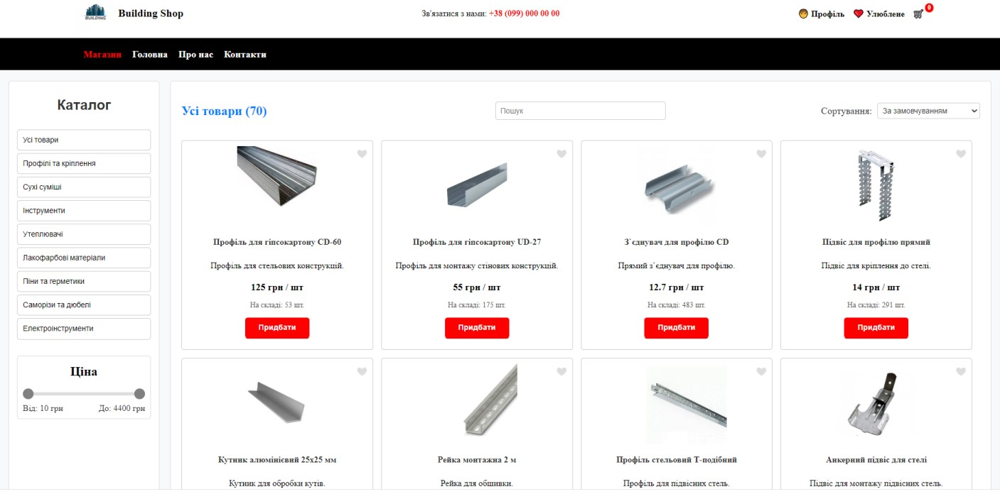
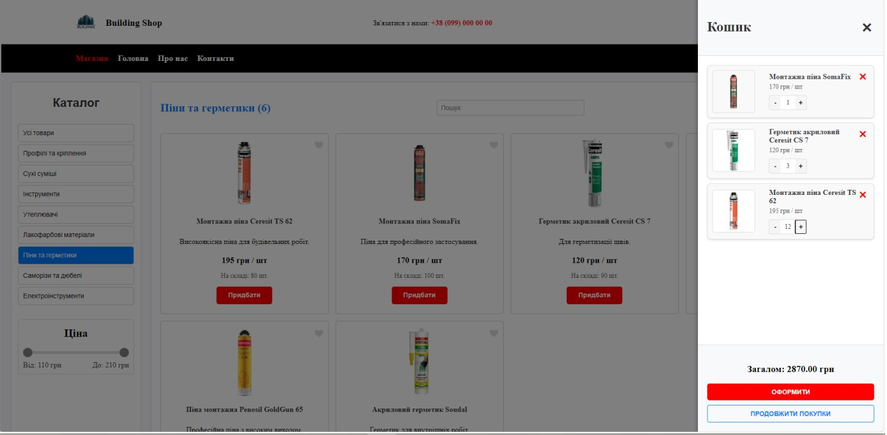
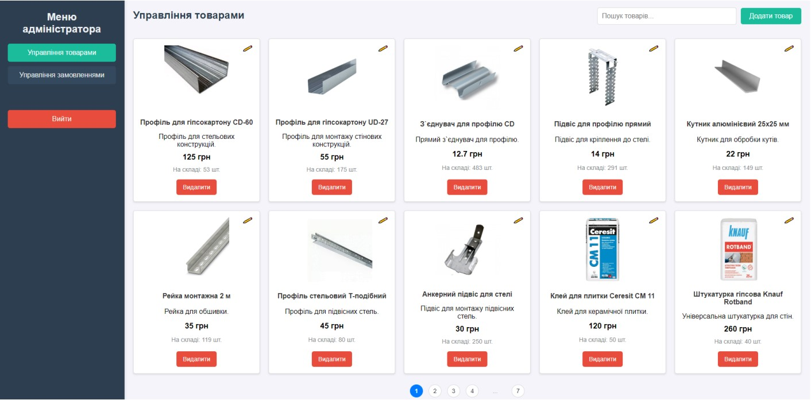

# Building Materials Online Store

A full-stack e-commerce web app for selling building materials. Customers can browse a catalog, filter and search products, manage a cart and place orders. Admins manage products and orders from a separate panel.

Built as a university coursework project (Lviv Polytechnic National University).

## Features

**Customers**

- Product catalog with categories and subcategories
- Search by name and description
- Filtering by category, subcategory and price range
- Sorting by name and price
- Cart: add, remove, change quantity
- Checkout with delivery details (Nova Poshta branch, cash payment)
- Registration and login (passwords hashed with bcrypt)
- Profile: edit data, change password
- Favorites list
- Order history with statuses

**Admin**

- Add, edit and delete products
- Search products
- View all orders, filter by status, change status, delete orders
- Access restricted by user role

## Tech stack

| Layer    | Technology                                                |
| -------- | --------------------------------------------------------- |
| Frontend | React, React Router, HTML, CSS, JavaScript                |
| Backend  | Node.js, Express.js (REST API)                            |
| Database | SQLite                                                    |
| Auth     | bcrypt password hashing, role-based access (user / admin) |
| Tools    | Git, Visual Studio Code                                   |

## Database

Tables: `Users`, `Products`, `Categories`, `Subcategories`, `Cart`, `Favorites`, `Orders`, `OrderItems`, `Stock`.

## Getting started

Requirements: Node.js 18+ and npm.

```bash
# 1. Clone the repository
git clone https://github.com/volodyalaniak/<repo-name>.git
cd <repo-name>

# 2. Install dependencies
npm install

# 3. The SQLite database is in src/db/database.db
#    (to recreate it, run src/db/statement.sql in SQLite)

# 4. Start the API server (http://localhost:5000)
node server.js

# 5. Start the client in a second terminal
npm run dev
```

Open http://localhost:5173 in your browser.

## Screenshots

The interface is in Ukrainian.

### Catalog with search, filters and sorting



### Cart



### Admin panel



## Author

Volodymyr Laniak
